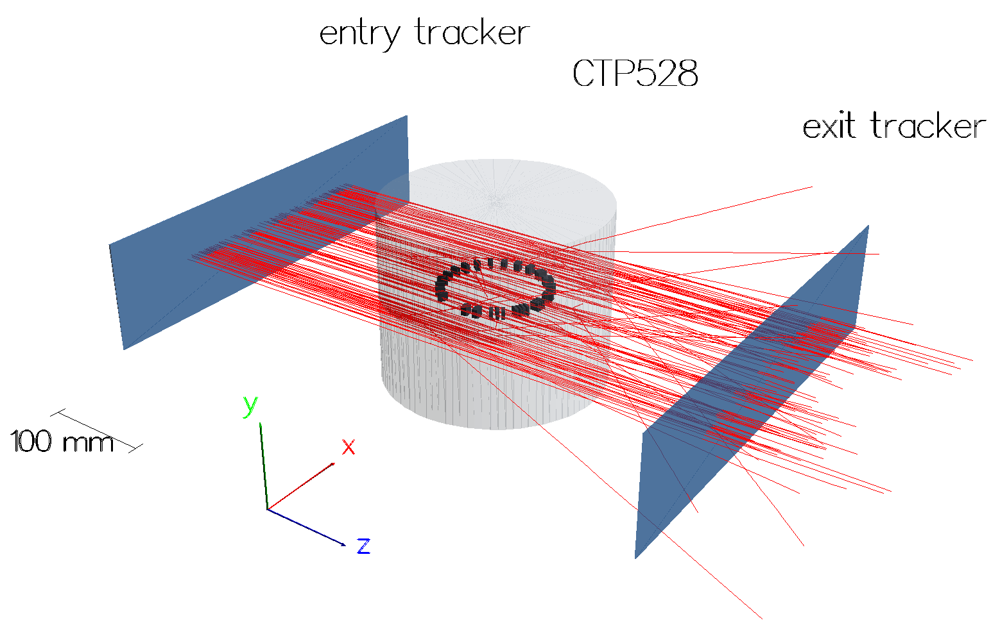

# protonct-sim — Geant4 proton CT simulations

This Geant4 application models a proton computed tomography (pCT) acquisition process.

See the [pct-tools](https://github.com/mhentz/pct-tools) package for a Python library you can use in your reconstructions of the simulated data.

The transport of protons through a chosen CT phantom is simulated. Individual protons' position, direction of travel, and energy are recorded from detector regions placed in front and behind the phantom (from the beam nozzle perspective). A full acquisition is obtained by rotating the phantom through a set of projection angles, with one Geant4 run per projection.



Visualisation of the single-tracking set-up with the CTP528 module of the Catphan phantom in the realistic configuration. The red lines are the trajectories of 120 protons at 200 MeV and the blue panes are the entry and exit tracking detectors; the aluminium line-pair inserts are visible at the centre of the water cylinder.

Several phantoms are available (`ctp528`, `gammex`, `spiral`, and `water`, among others), each of which may be simulated with an "ideal" or a "realistic" detector setup. The two setups differ in the detector dimensions and distance from the phantom (10 mm versus 150 mm) and in the beam source definition; see the macros under `source/macros/`.

These measurements provide a dataset that can later be used to generate pCT image reconstructions. For each projection they are written to a ROOT file containing two ntuples, `In` and `Out`, which hold the kinetic energy, lateral position, direction cosines, and event and run IDs of every primary proton crossing the entry and exit detectors respectively (only protons that reach both detectors are stored). Dose and fluence scored in the phantom region are dumped alongside. Scripts for submitting the projections of an acquisition as batch jobs on a Sun Grid Engine cluster are provided under `source/scripts/`.

## Building the simulation

The current version requires [Geant4](https://github.com/Geant4/geant4) 11.0 or later (multi-threading is recommended) and CMake 3.16 or higher; see the [Geant4 installation guide](https://geant4-userdoc.web.cern.ch/UsersGuides/InstallationGuide/html/index.html) for setting it up. The simulation is built as follows:

```
$ git clone https://github.com/mhentz/protonct-sim.git
$ cd protonct-sim
$ mkdir build
$ cd build
$ cmake ../source
$ make
```

To run it with UI and VIS:

```
$ ./protonct-sim
```

To run it in batch mode, pass a macro instead, for example `./protonct-sim my_acquisition.mac`; see [docs/usage.md](docs/usage.md).

## Documentation

- [Introduction](docs/introduction.md): background on proton CT
- [Installation](docs/installing.md)
- [How the simulation works](docs/architecture.md)
- [Phantoms](docs/phantoms.md)
- [Running the simulation](docs/usage.md): macros, commands and batch jobs
- [Output](docs/output.md): ROOT ntuples and scoring files

## How to cite

If you use this software, please cite the thesis it was developed for:

M. Hentz, *Iterative Reconstruction using Structural Priors in Proton Computed Tomography*, PhD thesis, University College London, 2026.

Software metadata are in [CITATION.cff](CITATION.cff).

## Acknowledgements

The geometry of the Catphan CTP528 module was adapted from code written by Charles-Antoine Collins-Fekete (University College London), who kindly agreed to its inclusion here.

This product includes software developed by Members of the Geant4 Collaboration (http://cern.ch/geant4).

## Licence

This project is released under the BSD 3-Clause License; see [LICENSE](LICENSE).

